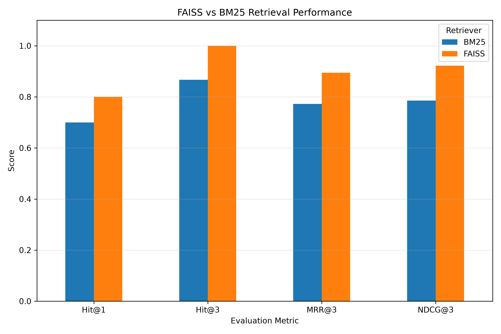
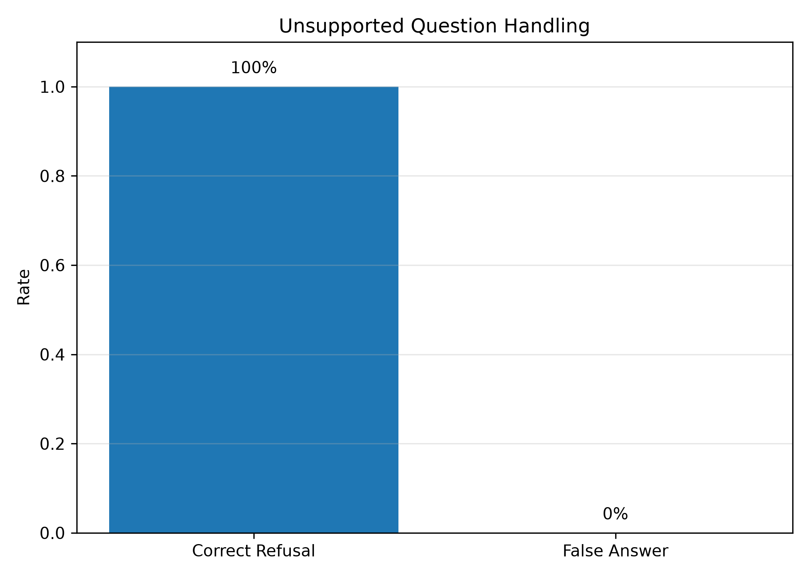

# WIL Project 71 - Test-Driven RAG

## Small Business Cybersecurity Assistant

This project develops a **Test-Driven Retrieval-Augmented Generation (RAG)** system for Australian small businesses.

The application allows users to ask cybersecurity questions in natural language. Relevant information is retrieved from Australian Cyber Security Centre guidance documents and supplied to a locally running **Llama 3.2** model through **Ollama**.

The final prototype is delivered through a **Streamlit web application** and displays the source documents and page numbers used to support the generated answer.

---

## Group Information

**Group ID:** 71

| Student ID | Name |
| s4143216 | Rohan Chaudhari |
| s4205433 | Arrvind Sethuraman |
| s4229902 | Parth Kalsariya |
| s4214674 | Divyansh Shrimali |

### Trello Board

https://trello.com/b/W2VvIHqY

---

# Business Problem

Small businesses may not have dedicated cybersecurity teams and may find it difficult to locate useful information across multiple technical cybersecurity documents.

Important guidance about ransomware, phishing, email compromise, passwords, backups, multi-factor authentication and cloud security can be distributed across different documents.

This project provides a simple question-answering interface that helps users retrieve relevant cybersecurity guidance more quickly.

---

# Project Objective

The system was designed to:

- answer cybersecurity questions using a controlled knowledge base
- retrieve relevant passages from cybersecurity documents
- generate responses grounded in retrieved information
- display supporting document names and page numbers
- refuse questions outside the available knowledge base
- compare different retrieval approaches quantitatively
- demonstrate a test-driven approach to RAG development

---

# System Architecture

```text
User
  |
  v
Streamlit Web Application
  |
  v
User Question
  |
  v
Sentence Transformer Embedding
all-MiniLM-L6-v2
  |
  v
FAISS Semantic Retrieval
  |
  v
Relevant Document Chunks
  |
  v
Llama 3.2 through Ollama
  |
  v
Grounded Answer
  |
  +----> Source Documents + Page Numbers
```

---

# Technology Stack

| Component | Technology |
|---|---|
| Language | Python |
| Web interface | Streamlit |
| PDF processing | PyMuPDF |
| Text splitting | LangChain Text Splitters |
| Embedding model | all-MiniLM-L6-v2 |
| Semantic retrieval | FAISS |
| Baseline retrieval | BM25 |
| Language model | Llama 3.2 |
| LLM runtime | Ollama |
| Evaluation | Pandas / Python |
| Visualisation | Matplotlib |
| Version control | Git / GitHub |

---

# Knowledge Base

The project uses five cybersecurity guidance documents:

```text
ACSC small business cloud security guides - Executive Overview.pdf

ACSC_Ransomware_Prevention_Guide_05082022_0.pdf

Email attacks_Emergency Response Guide.pdf

Email attacks_Prevention Guide.pdf

Small business cybersecurity guide (January 2025).pdf
```

The knowledge base covers topics including:

- ransomware prevention and response
- phishing
- business email compromise
- multi-factor authentication
- passwords and passphrases
- backups
- malware
- software updates
- cloud security
- account protection
- email authentication
- staff cybersecurity awareness

---

# Document Processing

PDF documents are processed using **PyMuPDF**.

The ingestion pipeline:

1. extracts text page-by-page
2. removes pages with insufficient extracted text
3. splits text into smaller chunks
4. attaches source-document metadata
5. stores the processed chunks for retrieval

The text splitting configuration is:

```text
Chunk size: 800 characters
Chunk overlap: 150 characters
```

The final processed knowledge base contains approximately:

```text
132 chunks
```

Each chunk stores:

```text
Document name
Page number
Chunk ID
Text
```

---

# Embeddings

The project uses:

```text
sentence-transformers/all-MiniLM-L6-v2
```

The embedding model converts document chunks and user questions into numerical vectors.

These vectors are used by FAISS to identify semantically similar content.

---

# Retrieval Methods

Two retrieval approaches were implemented.

## FAISS

FAISS performs semantic vector retrieval.

It attempts to find information that is conceptually similar to the user's question even when the wording is different.

## BM25

BM25 was implemented as a keyword-based baseline.

It relies more heavily on matching important terms between the question and document chunks.

Both methods were evaluated quantitatively before choosing the final retrieval approach.

---

# LLM and Answer Generation

The system uses:

```text
Llama 3.2
```

running locally through:

```text
Ollama
```

The model is instructed to:

- use only retrieved context
- avoid unsupported facts
- avoid inventing recommendations
- ignore incomplete text fragments
- keep answers concise
- prioritise prevention guidance when appropriate
- prioritise incident-response guidance when appropriate
- refuse questions that cannot be answered from the knowledge base

The model does not generate source filenames itself.

Instead, the application retrieves exact source names and page numbers from document metadata.

---

# Unsupported Questions

The fallback response is:

```text
I cannot answer this question from the available cybersecurity documents.
```

For example:

```text
Question:
How do I repair the engine in my car?

Answer:
I cannot answer this question from the available cybersecurity documents.
```

When the system refuses a question, no cybersecurity sources are displayed.

---

# Streamlit Application

The final prototype includes a browser-based interface built using Streamlit.

Users can:

- enter a cybersecurity question
- receive a generated answer
- view supporting documents
- view source page numbers
- receive a fallback response for unsupported questions

The interface also explains that the prototype provides general information and does not replace professional cybersecurity, legal or incident-response advice.

---

# Evaluation Methodology

The final evaluation dataset contains:

```text
40 questions
```

It is divided into:

```text
30 answerable cybersecurity questions
10 unsupported questions
```

The 30 answerable questions are used to compare FAISS and BM25 retrieval.

The 10 unsupported questions are used to measure whether the final RAG system correctly refuses questions outside its knowledge base.

---

# Retrieval Metrics

Four retrieval metrics were used.

### Hit@1

Measures whether a relevant document is ranked first.

### Hit@3

Measures whether at least one relevant document appears within the first three retrieved sources.

### MRR@3

Mean Reciprocal Rank measures how highly the first relevant result is ranked.

### NDCG@3

Normalized Discounted Cumulative Gain measures ranking quality while giving greater importance to relevant results appearing near the top.

---

# Final Retrieval Results

The final evaluation on 30 answerable questions produced:

| Retriever | Hit@1 | Hit@3 | MRR@3 | NDCG@3 |
|---|---:|---:|---:|---:|
| BM25 | 0.7000 | 0.8667 | 0.7722 | 0.7857 |
| FAISS | **0.8000** | **1.0000** | **0.8944** | **0.9218** |

FAISS performed better than BM25 across all four metrics in the final evaluation.

FAISS achieved:

```text
Hit@1 = 80%
Hit@3 = 100%
MRR@3 = 0.8944
NDCG@3 = 0.9218
```

A Hit@3 score of 1.00 means that at least one labelled relevant source appeared within the first three unique retrieved sources for all 30 answerable evaluation questions.

Based on these results, **FAISS was retained as the retriever in the final prototype**.

---

# Retrieval Performance Chart



---

# Unsupported Question Evaluation

The final RAG system was also tested using 10 unsupported questions.

Results:

| Metric | Result |
|---|---:|
| Unsupported questions | 10 |
| Correct refusals | 10 |
| Refusal accuracy | **100%** |
| False answer rate | **0%** |

The 100% refusal result applies specifically to this 10-question test set and should not be interpreted as a guarantee for every possible unseen question.

---

# Unsupported Question Chart



---

# Evaluation Files

```text
evaluation/
│
├── evaluate_final.py
├── plot_results.py
├── test_questions_40.csv
├── retrieval_results_30.csv
├── retrieval_summary_30.csv
├── refusal_results_10.csv
├── refusal_summary_10.csv
│
└── figures/
    ├── retrieval_comparison.png
    └── unsupported_question_results.png
```

### `test_questions_40.csv`

Contains the complete evaluation dataset.

### `retrieval_results_30.csv`

Contains detailed FAISS and BM25 results for each answerable question.

### `retrieval_summary_30.csv`

Contains the overall retrieval metrics.

### `refusal_results_10.csv`

Contains the result for each unsupported question.

### `refusal_summary_10.csv`

Contains the overall refusal accuracy and false-answer rate.

---

# Project Structure

```text
WIL-Project-71-RAG/
│
├── app.py
├── README.md
├── requirements.txt
├── .gitignore
│
├── .streamlit/
│   └── config.toml
│
├── data/
│   ├── raw/
│   │   └── cyber_docs/
│   │
│   └── processed/
│       ├── chunks.json
│       └── faiss_index/
│
├── src/
│   ├── ingest.py
│   ├── build_vectorstore.py
│   ├── rag.py
│   ├── bm25_retriever.py
│   ├── test_retrieval.py
│   ├── test_bm25.py
│   └── compare_retrievers.py
│
├── evaluation/
│   ├── evaluate_final.py
│   ├── plot_results.py
│   ├── test_questions_40.csv
│   ├── retrieval_results_30.csv
│   ├── retrieval_summary_30.csv
│   ├── refusal_results_10.csv
│   ├── refusal_summary_10.csv
│   │
│   └── figures/
│       ├── retrieval_comparison.png
│       └── unsupported_question_results.png
│
├── docs/
│
└── notebooks/
```

---

# How to Run the Project

## 1. Clone the repository

```powershell
git clone https://github.com/Ron8203/WIL-Project-71-RAG.git
cd WIL-Project-71-RAG
```

## 2. Create the virtual environment

```powershell
python -m venv .venv
```

Activate it:

```powershell
.venv\Scripts\Activate.ps1
```

## 3. Install dependencies

```powershell
pip install -r requirements.txt
```

## 4. Install Ollama and download Llama 3.2

Make sure Ollama is installed.
If not installed
install it from the terminal with winget:
winget install Ollama.Ollama

Check:

```powershell
ollama --version
```

Download the model:

```powershell
ollama pull llama3.2
```

## 5. Process the PDF documents

```powershell
python src\ingest.py
```

## 6. Build the FAISS index

```powershell
python src\build_vectorstore.py
```

## 7. Run the Streamlit application

```powershell
streamlit run app.py
```

Open:

```text
http://localhost:8501
```

## 8. Run the final evaluation

```powershell
python evaluation\evaluate_final.py
```

## 9. Generate evaluation charts

```powershell
python evaluation\plot_results.py
```

---

# Key Findings

The project demonstrated that testing retrieval methods is important before choosing the final RAG configuration.

Although BM25 performed well for some terminology-heavy questions, the expanded 30-question evaluation showed that FAISS performed better overall.

The final results also showed that the prototype was able to retrieve relevant cybersecurity documents consistently within the top three results for the tested answerable questions.

The unsupported-question evaluation showed that the final system correctly refused all 10 tested out-of-domain questions.

---

# Limitations

The prototype has several limitations.

- The knowledge base contains only five cybersecurity documents.
- The final evaluation contains 40 questions and does not represent every possible user query.
- Relevance labels were manually assigned.
- Retrieval is evaluated primarily at document level rather than detailed chunk level.
- Strong retrieval performance does not guarantee that every generated sentence is correct.
- LLM output may vary between runs or software versions.
- The 100% refusal rate applies only to the 10 tested unsupported questions.
- Ollama and Llama 3.2 must be installed locally.

---

# Future Improvements

Possible improvements include:

- increasing the number of cybersecurity documents
- expanding the evaluation dataset
- testing more difficult or ambiguous questions
- implementing hybrid FAISS + BM25 retrieval
- adding reranking
- evaluating chunk-level relevance
- measuring answer faithfulness
- evaluating source attribution correctness
- testing additional embedding models
- comparing different local LLMs
- adding similarity thresholds
- improving unsupported-question detection
- measuring response latency
- adding conversation history
- adding clickable original-document links
- conducting user testing with small-business users

---

# Ethical and Responsible Use

This prototype provides general cybersecurity information from a limited knowledge base.

It is not intended to replace:

- professional cybersecurity advice
- legal advice
- regulatory advice
- professional incident-response services

Displaying source documents and page numbers improves transparency by allowing users to identify where retrieved information originated.

The refusal mechanism is designed to reduce unsupported responses when the system does not have sufficient information.

---

# Business Value

The prototype demonstrates how RAG can make cybersecurity information easier to access for small businesses.

Potential value includes:

- reducing time spent searching multiple PDF documents
- providing a natural-language interface
- directing users to relevant guidance
- showing source document names
- showing source page numbers
- improving accessibility of technical information
- reducing unsupported answers through refusal handling

The system is intended as a prototype demonstrating value rather than a complete cybersecurity advisory platform.

---

# Conclusion

This project demonstrates a complete **Test-Driven RAG workflow** for a small-business cybersecurity use case.

The final prototype combines:

- PDF ingestion
- text chunking
- document metadata
- Sentence Transformer embeddings
- FAISS semantic retrieval
- BM25 baseline retrieval
- Llama 3.2
- Ollama
- Streamlit
- grounded answer generation
- source display
- unsupported-question handling
- quantitative evaluation

Final FAISS results:

```text
Hit@1  = 0.8000
Hit@3  = 1.0000
MRR@3  = 0.8944
NDCG@3 = 0.9218
```

Unsupported-question evaluation:

```text
Correct refusals  = 10/10
Refusal accuracy  = 100%
False answer rate = 0%
```

The results demonstrate how quantitative evaluation can guide RAG design decisions and help determine which retrieval approach should be used in the final system.
